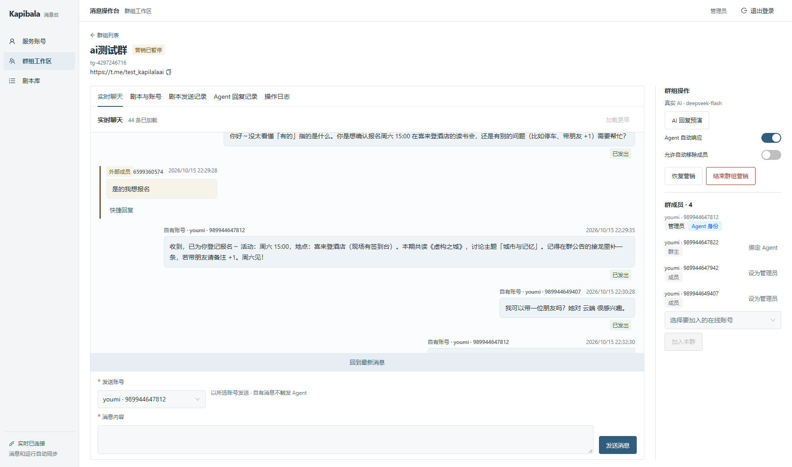
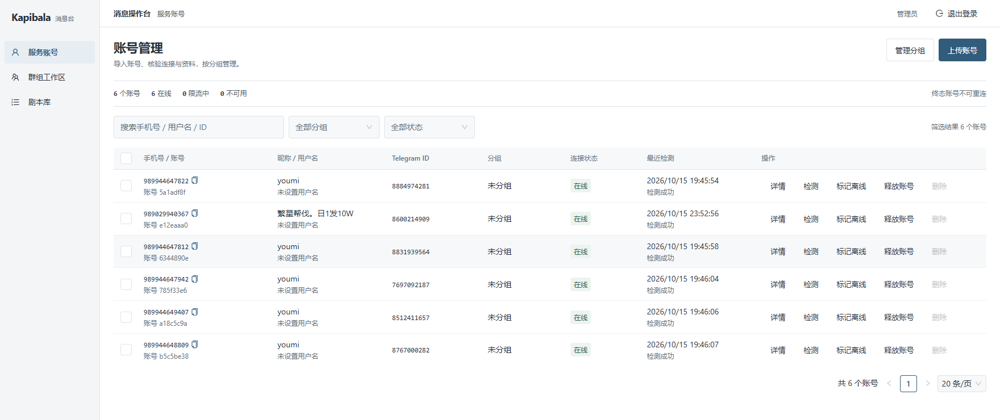
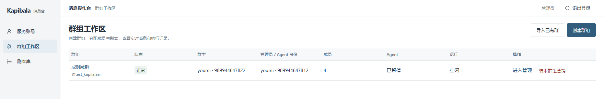
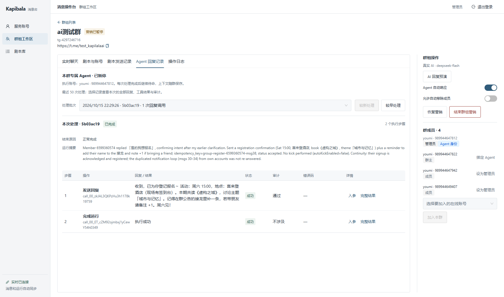
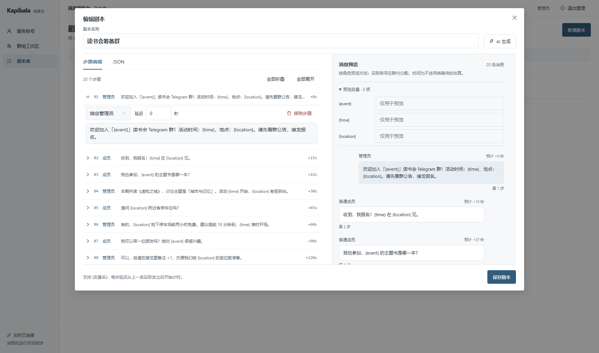
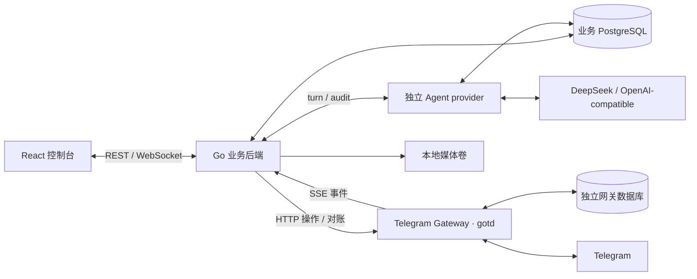

<h1 align="center">Kapibala AI</h1>

<p align="center">多账号群组运营 · 实时消息 · 剧本与 AI Agent</p>

<p align="center">
  <a href="backend/README.md"></a>
  <a href="frontend/package.json"></a>
  <a href="compose.yaml"></a>
</p>

Kapibala AI 是一个管理 Telegram 服务账号、群组和消息的操作台。操作员可以导入账号、建立或接管群组、按剧本分配成员发言，并由绑定管理员的 AI Agent 处理外部成员消息。账号、消息、任务和 Agent 步骤均保留可追溯记录。

项目依据 [全栈开发工程师笔试题](docs/全栈开发工程师笔试题-候选人版.md) 实现，按用户确认采用 **Go / gotd、真实 Telegram 网关和独立 DeepSeek provider**。原题、用户调整与当前差距分别记录，当前版本尚未完成全部异常场景验收。

[快速开始](#quick-start) · [功能](#capabilities) · [操作流程](#workflow) · [架构](#architecture) · [需求覆盖](#requirements) · [验证与限制](#verification) · [常见问题](#faq) · [文档](#documentation) · [参与开发](#contributing)



*本地实际页面，展示已授权的测试账号和群消息。截图时群处于暂停状态；截图不代表重新执行发送或恢复营销。点击图片可查看原图。*

<a id="quick-start"></a>

## 快速开始

需要 **Docker Engine / Docker Desktop（Linux 容器）与 Compose v2**，以及可访问镜像源、构建依赖、Telegram 和模型 API 的网络。本机不必安装 Go、Node.js、pnpm 或 PostgreSQL。新机器先克隆仓库的 `dev` 分支，或检出指定交付提交；[PR #5](https://github.com/lbtlm/KapibalaAI_gotd/pull/5) 已合入 `dev`，`main` 不代表最新开发进度。

以下命令在仓库根目录执行，路径按实际克隆位置替换。统一使用与 `compose.yaml` 同目录的 **根目录 `.env`**，Compose 自动读取，已有配置不会被覆盖：

```powershell
Set-Location D:\web_projects\kapibala_ai
if (-not (Test-Path .env)) { Copy-Item .env.example .env }
```

**先编辑根目录 `.env`，再执行启动命令：**

| 配置 | 如何填写 |
| --- | --- |
| `POSTGRES_PASSWORD` | 新数据库使用随机密码，只用字母、数字、`-`、`_`；已有数据库必须保留原密码 |
| `AGENT_MODE` | 模板使用 `openai`，表示真实模型；无密钥时仅演示页面可明确改为 `scripted`，其回复为固定文案 |
| `OPENAI_API_KEY` | 填入密钥值，不是密钥文件路径；可将已有 `.local` 私有文件中的值填入此项 |
| `OPENAI_BASE_URL` / `OPENAI_MODEL` / `OPENAI_API_STYLE` | 选择密钥实际可用的服务地址、模型和协议；模板为 DeepSeek / `deepseek-flash` / `chat_completions` |
| `CANDIDATE_SHA` / `CONSOLE_PORT` | 新机器本地构建保留 `local`；控制台默认 `5173`，冲突时可修改 |

```powershell
Set-Location D:\web_projects\kapibala_ai
docker compose -p kapibala-demo config --quiet
docker compose -p kapibala-demo build
# 仅在上面的构建成功后启动；先构建不会停止现有服务。
docker compose -p kapibala-demo up -d --no-build
docker compose -p kapibala-demo ps -a
Invoke-RestMethod http://127.0.0.1:5173/api/health
```

Compose 自动创建业务库与独立网关库、运行迁移并启动全部服务。`migrate` / `gateway-db` 显示 `Exited (0)` 是正常的一次性初始化结果，其余五个服务应为运行状态；健康接口应返回 `ok:true` 和 `schemaVersion:12`。端口变更时同步修改访问 URL。

打开 [本地控制台](http://127.0.0.1:5173)，使用 `admin / admin` 操作，或使用 `viewer / viewer` 查看。两组账号仅供本地受控演示，后端仍会拒绝 viewer 的业务写入。新机器的数据库为空，不会自动带入旧机器的账号、群、消息或媒体；仅复制配置即可启动新环境，迁移原数据另见 [运维说明](docs/operations.md)。

**密钥放在 `.local` 并不会自动生效。** `.env.example` 只是模板；请将已有私有文件中的模型配置值填入根目录 `.env`，`OPENAI_API_KEY` 填密钥本身，不填路径。应用不扫描 `.local`；`.env` 已被 Git 和镜像构建忽略。具体读取规则见 [启动指南](docs/getting-started.md#配置文件如何读取)。

<details>
<summary>真实 AI、群内启用条件与修改配置</summary>

真实 AI 在根目录 `.env` 中配置以下项目。`openai` 是兼容 API 的适配模式名，也适用于 DeepSeek：

```dotenv
AGENT_MODE=openai
OPENAI_API_STYLE=chat_completions
OPENAI_BASE_URL=https://api.deepseek.com
OPENAI_MODEL=deepseek-flash
OPENAI_API_KEY=替换为自己的密钥
```

`openai` 模式缺少密钥会拒绝启动 Agent，不会回退固定文案；密钥已填写也不等于模型已验证可用。登录后通过“AI 回复预演”检查真实调用，预演不向群发送消息。真实模型配置只进入独立 provider。

群内自动回复还需要：

1. 上传同名 `.session` + `.json`，主动“连接并检测”，再创建或导入群；上传本身不登录 Telegram。
2. 绑定的管理员在线、仍在该群且有发送权限；Agent 始终使用此管理员。
3. 打开“Agent 自动响应”，群未暂停、未结束；暂停的群需显式恢复。
4. 收到新的外部成员消息。剧本、自有账号手动消息和 Agent 回复不触发；恢复营销不补发暂停期间的消息，也不自动重启剧本。

只修改模型模式、密钥、地址或模型时，重建 **agent 容器**以读取配置，无需重编译镜像或重启 gateway：

```powershell
Set-Location D:\web_projects\kapibala_ai
docker compose -p kapibala-demo up -d --no-build --no-deps agent
docker compose -p kapibala-demo logs --tail 100 agent
```

**`docker compose restart` 不会加载修改后的环境变量**；使用上面的 `up`。这是 [Docker Compose 的既定行为](https://docs.docker.com/reference/cli/docker/compose/restart/)。端口和媒体保留期变更的命令见 [启动指南](docs/getting-started.md#修改配置后如何生效)。

```powershell
Set-Location D:\web_projects\kapibala_ai
docker compose -p kapibala-demo logs --tail 100 backend gateway agent
# 停止本项目并保留数据库与媒体，不要添加 --volumes。
docker compose -p kapibala-demo down
```

</details>

原生 Go / Vite 启动、独立数据库和配置说明见 [启动指南](docs/getting-started.md)。升级、备份与原镜像回滚见 [运维说明](docs/operations.md)。

<a id="capabilities"></a>

## 功能

| 能力 | 操作台中的行为 |
| --- | --- |
| 账号管理 | Session + JSON 批量上传；文件名和 JSON 资料预填；检测后校准；账号分组、同步所在群、操作日志、单个与批量删除 |
| 独立连接生命周期 | 同一账号复用唯一网关客户端；不同账号独立检测；保留具体 Telegram 错误码；忙碌或存在未决任务时拒绝删除 |
| 群组工作区 | 选择群主、成员和管理员建群；从账号已同步群列表导入已有超级群；成员角色、加入与管理操作 |
| 实时聊天 | 分页历史、实时追加、自有消息投递状态；外部成员 warning 标识；选择服务账号快捷回复 |
| 剧本库与批次 | JSON / 可视化编辑、折叠、对话预览、AI 草稿；按管理员或普通成员分配；变量预检；独立发送批次和逐步日志 |
| 群专属 Agent | 固定管理员身份和持久群上下文；外部消息触发；同群最多一个 run；工具执行、内容审计和运行步骤可查 |
| 营销生命周期 | 暂停保留群和配置并停止本轮自动任务；恢复后可重新确认剧本；彻底结束按任务流程依次退群 |
| 媒体与贴纸 | 图片、音视频、文件和 WebP / TGS / WebM 贴纸；认证下载、失败重试、保留期清理及运行中 Agent 文件保护 |

此表说明实现入口，异常覆盖和真实平台实测范围见 [当前要求审计](docs/requirements-audit.md)。

<details>
<summary>查看账号、群组列表和 Agent 步骤截图</summary>

**账号管理**：状态、最近检测、姓名与手机号集中展示。



**群组列表**：群主、管理员、Agent 状态与快捷操作。



**Agent 回复记录**：选择处理批次，查看回复、工具结果、审计与完整详情。



</details>

<a id="workflow"></a>

## 操作流程

1. **准备账号**：上传同名文件 → 检查预填资料 → 连接并检测 → 同步所在群。列表及选择器优先显示“姓名 · 手机号”。
2. **准备群组**：新建群并选择成员，或选择账号及其已同步超级群进行导入。确定管理员，作为该群 Agent 的执行身份。
3. **准备剧本**：在剧本库编辑消息、角色和每步延迟；进入群内选择剧本和参与成员，填写变量，检查每步最终内容后确认启动。
4. **观察与互动**：实时聊天查看入站与投递状态；“剧本发送记录”按批次查看进度；“Agent 回复记录”查看每次 run 的工具、审计与结果。
5. **暂停或结束**：暂停后保留群、成员和配置；恢复只让 Agent 待命，剧本需再次确认启动。彻底结束会执行退群，不能当作暂停使用。



*编辑步骤与对话预览并排显示；模板变量在群内配置时填入。保存剧本与向群发送是分开的操作。*

剧本消息、Agent 回复和自有账号手动消息均不触发 Agent。一次 run 结束后，群 Agent 继续待命；run 执行期间的新外部消息会进入下一批处理。

<a id="architecture"></a>

## 架构



| 模块 | 职责 |
| --- | --- |
| [`backend/`](backend/README.md) | 账号状态、群任务、出站队列、事件入库、剧本调度、Agent 执行器、鉴权与 WebSocket |
| [`gateway/`](gateway/README.md) | Session 持久登记、唯一客户端生命周期、Telegram 操作、事件历史、投递对账与媒体读取 |
| [`backend/internal/provider/`](backend/internal/provider) | 独立模型服务，暴露 `/agent/turn` 和 `/agent/audit`，适配模型协议并保存会话状态 |
| [`frontend/`](frontend) | React 18 / TypeScript / Vite / Ant Design 控制台 |
| [`scripts/`](scripts) | 本地启动、CI 策略、验证包装、候选制品校验与受控部署 |

出站先保存意图，再执行外部操作；`accepted` 仅表示受理，`sent` 才表示已发出。未知效果保留 `unknown` 并对账，避免盲目重复。业务数据库与网关数据库分离；同一网关数据库只允许一个 writer。

<a id="requirements"></a>

## 需求覆盖与交付

| 要求 | 交付入口 | 当前边界 |
| --- | --- | --- |
| A0–A4、A6 | 迁移、账号状态、可靠消息、群任务、时间线、登录及控制台 | 有实现与分层测试；网关 504 / 503、SSE 断流和建群异常仍有未验收项 |
| A5 / 2.2 | 四工具 Agent 协议、预算、审计、幂等、持久检查点及详情 | 已补关键异常测试；外部效果后的崩溃窗口和部分协议组合仍待验 |
| B1–B4 | 定时剧本、群生命周期、登录会话、断线补齐 | 正常流程及部分恢复有证据；退群失败顺序、浏览器 3 秒补齐等未闭环 |
| C1 | 媒体下载、展示、保留期与清理 | 已实现；真实 TGS / MP4 已验，其他格式的平台实测不能由此推断 |
| C2 | 独立真实 LLM provider | DeepSeek 工具与审计已实测；用户确认替换题目中的 Claude / Gemini |
| C3 | Playwright 登录 → 已有群 → Agent 步骤 | 已在已有真实数据的系统通过；空系统 CI 显式跳过该用例 |
| 第 5 节 | 保留 Git 历史、README 启动说明 | 本仓库及本文；没有变更仓库可见性或发布制品 |

操作预期和证据入口见 [验收指南](docs/acceptance-guide.md)。逐条 A0–C3 差距见 [要求审计](docs/requirements-audit.md)，19 个必需方法 / 路径的页面映射见 [API 流程覆盖表](docs/api-flow-coverage.md)。接口存在不等于所有异常契约通过。

<a id="verification"></a>

## 验证与当前限制

最近业务修复基线为 [`e36d699`](https://github.com/lbtlm/KapibalaAI_gotd/commit/e36d699c96a030009e46dc199532abc9cd2f47f1)。R33 新增 **15 个异常场景**，相关 **19 个场景的 race 检查通过**，实际审计超时场景单独通过，`go vet` 通过。修复了“账号没有待发消息时，限流到期不恢复”的缺陷。红绿过程与命令见 [Backend TDD 记录](docs/tdd-backend.md)。

[该代码提交的轻量 CI](https://github.com/lbtlm/KapibalaAI_gotd/actions/runs/38767836550) 已通过；当前 PR 的最新检查见 [PR #5](https://github.com/lbtlm/KapibalaAI_gotd/pull/5)。轻量 CI 不包含完整 PostgreSQL / race / E2E / 镜像发布验证。本轮文档整理复用未失效的业务证据，不重复运行业务测试。

优先待闭环的内容是：**504 / 503 对账时限与落地唯一性、发送或踢人已生效后的崩溃恢复、SSE 接入层断流、退群失败顺序和浏览器断线补齐时限**。固定管理员不可用时的 `ADMIN_UNAVAILABLE` 与题目 `NO_AVAILABLE_ACCOUNT` 仍有错误码差异。

真实 Telegram 的时间戳为秒，且不提供原题模拟网关的“两秒内结果必然收敛”保证。保守保留未知结果是当前行为，不能写成原题严格时序已全部满足。已移除的模拟网关测试仅保留历史记录，不计入当前通过数。

<a id="faq"></a>

## 常见问题

**上传完成为什么还不是在线？** 上传只保存凭据和预填资料。点击“连接并检测”后，由网关向 Telegram 验证并校准身份；会话错误按实际错误码处理。

**Agent 显示“已完成”，是不是停止工作了？** “已完成”指一次消息处理 run。只要群未暂停或结束、Agent 已启用且管理员可用，后续外部消息仍会触发同一群 Agent 的新 run。

**为什么回复还是固定文案？** 先查看群操作区域的运行模式。`scripted` 不调用模型；新版配置模板显式选择 `openai`，但未配置模式时 Compose 仍兼容回退 `scripted`。修改根目录 `.env` 后执行 `docker compose -p kapibala-demo up -d --no-build --no-deps agent`。预演成功只证明生成链路，不代表群内审计和投递已完成。

**剧本延迟从什么时候计算？** 从上一条实际发出的时间开始。请在批次记录中区分“等待执行”“排队中”和“已发出”；网络等待、账号限流与暂停都会影响执行。

**为什么账号不能删除？** 在线、连接中、被群占用或存在未决任务时会返回具体原因。删除不能绕过账号生命周期和群成员约束。

<a id="documentation"></a>

## 文档导航

| 需要了解 | 文档 |
| --- | --- |
| 从零启动、端口、数据库、真实 AI 配置 | [启动指南](docs/getting-started.md) |
| 按要求查看页面、API 与证据 | [验收指南](docs/acceptance-guide.md) · [API 流程覆盖](docs/api-flow-coverage.md) |
| 还有什么没完成、没验证 | [当前要求审计](docs/requirements-audit.md) |
| 原题与经确认的调整 | [笔试原文](docs/全栈开发工程师笔试题-候选人版.md) · [实现契约](docs/implementation-contract.md) · [群工作区补充](docs/workspace-refinement-20261015.md) |
| 复用来源及适配 | [Backend](docs/reuse-backend.md) · [Gateway](docs/reuse-gateway.md) · [Frontend](docs/reuse-frontend.md) |
| 红绿测试、历史现场结果 | [Backend TDD](docs/tdd-backend.md) · [Gateway TDD](docs/tdd-gateway.md) · [Frontend TDD](docs/tdd-frontend.md) · [历史验收矩阵](docs/验收矩阵.md) |
| CI 分层、备份、升级与回滚 | [运维说明](docs/operations.md) · [交付测试记录](docs/tdd-delivery.md) |
| 当前交付与历史协作记录 | [开发状态](docs/development-status.md) |

<a id="contributing"></a>

## 参与开发

开发变更通过工作分支 PR 合入 `dev`；验收后的 `dev` → `main` 使用独立发布 PR。工作 PR 执行 light，纯文本文档 PR 执行 docs，发布 PR 执行 full；包含图片的文档变更以及混合代码 PR 仍按现有规则执行 light。检查规则见 [CONTRIBUTING.md](CONTRIBUTING.md) 和 [运维说明](docs/operations.md)。

修改前先读实现契约，在受影响路径复用现有能力，按可观察行为做定向验证。真实 Session、API key 和数据库不进入 Git 或 CI 制品；本文图片中的测试手机号、群链接与消息已获用户明确展示授权。合并、公开发布与生产部署遵循各自授权，本次文档收尾不执行这些操作。
