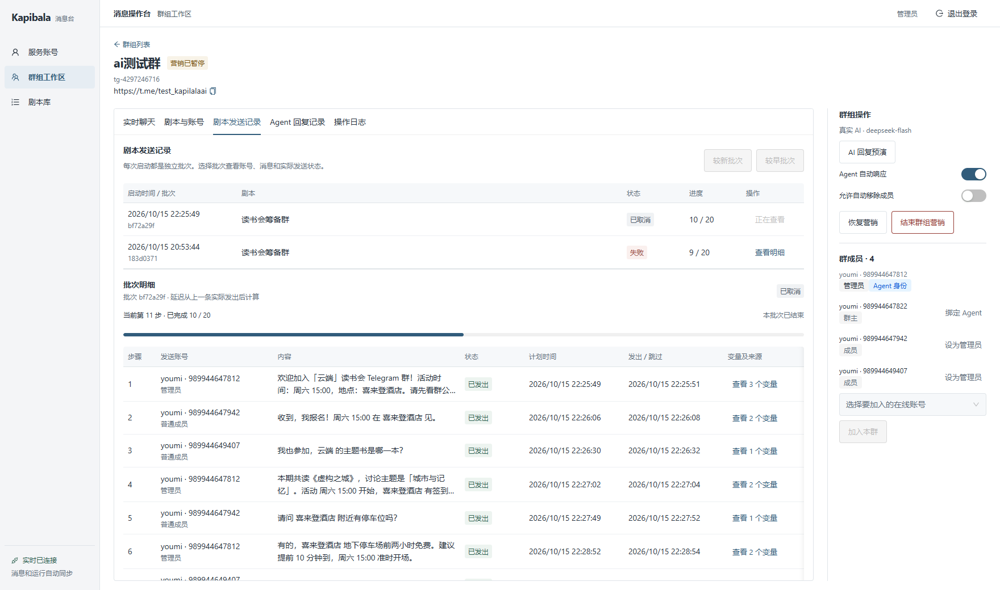

# 验收指南

[返回 README](../README.md) · [启动指南](getting-started.md) · [当前差距](requirements-audit.md) · [API 流程覆盖](api-flow-coverage.md)

本指南按“看到什么、如何操作、检查什么、证据到哪里查”组织。功能约定见 [实现契约](implementation-contract.md)，接口与调用链见 [API 流程覆盖](api-flow-coverage.md)。**页面截图、接口存在、自动化通过与真实平台验收是不同证据，不能互相替代。**

## 准备环境

- 按启动指南启动指定候选，确认 `/api/health` 返回 `ok:true`；记录提交 SHA 和 schema 版本。
- admin 可操作，viewer 只读。先用 viewer 查看已有数据，再用 admin 验证写入口。
- 新库没有 Telegram 账号、群和 Agent 历史，需要指定测试账号与测试群才能完成真实业务链。已有环境可直接查看历史，不必为截图或阅读日志再次发送。
- 下方六张图片来自本机现有页面，保留用户明确授权展示的测试手机号、群链接和消息。截图未生成新消息、启动剧本或切换群策略；当时群营销已暂停。

## 1. 账号管理

对应 A1、A6，以及上传、检测、分组和删除扩展。


操作路径：上传同名 Session + JSON → 检查手机号与资料预填 → 连接并检测 → 同步所在群。单个账号的检测状态不应锁住其他账号；检测结果需要保留具体错误码。删除只允许符合空闲与占用条件的账号，批量删除仍逐项检查。

验收时区分：上传成功仅代表持久登记；检测成功才代表 Telegram 身份验证；同步群只是发现账号已加入的群。失败会话、限流恢复与 CAS 冲突证据见 [要求审计 A1](requirements-audit.md) 和 [Backend TDD](tdd-backend.md)。

## 2. 群组与实时聊天

对应 A2–A4、B2、B4，以及群导入、管理员固定和营销暂停扩展。


新建群时选群主、有序成员与管理员；导入已有群时先选账号，再复用已同步群快照或主动同步，最后从超级群下拉列表选择。进入管理后，核对群主、管理员和成员身份。


检查消息时间、外部成员 warning 标识、姓名与手机号、已发出状态以及“加载更早”。快捷回复需明确选择服务账号；引用以消息中的文本呈现。图片、音视频和贴纸从受鉴权媒体接口读取；失败与过期应有明确状态，不能留下空白气泡。

暂停保留群和配置，停止本轮剧本及自动任务；恢复后 Agent 待命，剧本需要重新预检确认。彻底结束会依次退群，必须在可结束的指定测试群中验收。B2 退群失败顺序和 B4 浏览器三秒断线补齐仍在 [待验证清单](requirements-audit.md)，不能根据当前正常截图勾选通过。

## 3. 剧本编辑、预检与批次

对应 B1 和页面 5。


1. 在剧本库配置每步的管理员 / 普通成员角色、内容和延迟，或通过 JSON 编辑。AI 生成的是待采用草稿，预览后再保存。
2. 进入群内“剧本与账号”，选择剧本、参与的普通成员并填写变量。管理员步骤固定使用绑定管理员，成员步骤按选择顺序轮流发送。
3. 点击“检查并预览”，核对每步实际账号、消息、等待时间以及变量最终值与来源；变量缺失必须指出 `stepIndex` 和 `key`。
4. 只有确认才开始发送。预检本身不入发送队列；再次启动形成独立批次。



每步延迟从上一条**实际发出**后计算。记录中的 queued / accepted / sent 不可混为成功；长文本通过 Tooltip 阅读，变量详情使用独立弹窗。图中保留了现场已取消、失败批次，不将其包装为全部执行成功。

当前精确预检错误、无副作用与同群并发 201 / 409 已有定向证据；回执与重启交错、限流顺延等剩余边界见 [要求审计 B1](requirements-audit.md)。

## 4. Agent 运行与步骤

对应 2.2、A5、B4 和 C2。


群专属 Agent 绑定管理员，群上下文跨 run 保存。只有新外部成员消息触发；同群同时最多一个 run，处理中到达的外部消息归入下一次 run。一次 run 完成不等于群 Agent 停用。

检查运行状态、结束原因、工具名、入参、结果、审计和错误码。长 JSON 使用 Tooltip 或点击查看完整内容。`finish` / `end_turn` 是内部总结，真正群回复必须走 `send_message`、审计和投递链路；预演生成成功不能替代群内发送验收。

| 工具 | 需要检查 |
| --- | --- |
| `get_recent_messages` | 读取范围、排序、截断和自己的消息标识 |
| `send_message` | 固定管理员身份、审计通过后执行、同 key 不重复审计 / 入队、真实投递状态 |
| `kick_user` | 策略开关、权限、审计、成员结果与崩溃恢复；普通问答不覆盖此工具 |
| `finish` | 运行结束和摘要可见，不把摘要当成已发送消息 |

R33 已补审计异常、审计强杀恢复、同 key 复用与双实例串行测试。发送 / 踢人已产生外部效果后的崩溃窗口仍未验收；固定管理员不可用的错误码仍需对齐。具体见 [要求审计 A5](requirements-audit.md)。

## 5. API 与交付覆盖

[API 流程覆盖表](api-flow-coverage.md) 逐条列出 2.3 要求的 **19 个方法 / 路径组合**，包括 HTTP 和 WebSocket；B3 refresh / logout 另列。页面“连接并检测”走扩展 `/check`，保留的规范 `/connect` 路由需要独立验证，不能直接用按钮测试代替。

2.1 网关 API 与 2.2 turn / audit 是服务间接口。A5 四个工具不是四个额外页面 REST 入口。仓库保留 Git 历史和启动 README；原题的公开仓库交付建议未自动执行，仓库可见性仍按用户授权管理。

## 6. 如何复核测试证据

| 证据 | 入口 | 使用边界 |
| --- | --- | --- |
| 当前逐条完成度与优先级 | [requirements-audit.md](requirements-audit.md) | 当前判断入口；完整列表不在多处重复维护 |
| R33 关键异常与红绿过程 | [tdd-backend.md](tdd-backend.md) | 新增 15 场景；定向 race 19 场景通过；实际审计超时单独通过 |
| C1 媒体本地 / 现场验证 | [api-flow-coverage.md](api-flow-coverage.md) · [tdd-gateway.md](tdd-gateway.md) · [tdd-frontend.md](tdd-frontend.md) | TGS / MP4 有真实证据；其他格式不能自动算已实测 |
| C3 登录 → 群 → Agent 步骤 | [只读 Playwright 用例](../frontend/e2e/group-agent.spec.ts) | 使用已有群和 run；不生成新模型调用；空系统明确 skip |
| 当前代码基线 CI | [e36d699 的 CI](https://github.com/lbtlm/KapibalaAI_gotd/actions/runs/38767836550) | 已通过 light，不是发布 full；后续提交看 PR 最新检查 |
| 历史自动化与真实平台记录 | [验收矩阵](验收矩阵.md) | 保留原时间与候选；删除的网关模拟用例不再算当前通过 |

### 定向 Backend 检查

需要真实、隔离的 PostgreSQL 测试库。下面仅示例选择两个相关场景，端口和用户需匹配自己的安装；不要指向存放真实账号的数据库。

```powershell
Set-Location D:\web_projects\kapibala_ai\backend
$env:TEST_DATABASE_URL='postgres://kapibala@127.0.0.1:55432/kapibala_test?sslmode=disable'
go test -race ./internal/platform -run '^(TestRateLimitExpiresWithoutQueuedMessagesAcrossInstances|TestAgentTwoInstancesSerializeRunsAndCollectPendingExternalMessages)$' -count=1
```

缺少 DSN 导致的 skip 不是通过。账号删除跨服务用例另需实际空网关，见 [Backend README](../backend/README.md)。完整发布测试由 full CI 承担，日常修改按职责选用例；本次文档编辑没有重跑业务测试。

### C3 只读已有群

先准备已有群与持久 Agent 步骤的本地服务，再执行：

```powershell
Set-Location D:\web_projects\kapibala_ai\frontend
pnpm install --frozen-lockfile
$env:E2E_EXISTING_GROUP='1'
$env:E2E_BASE_URL='http://127.0.0.1:5173'
$env:E2E_API_URL='http://127.0.0.1:5173'
$env:E2E_BROWSER_CHANNEL='msedge'
pnpm exec playwright test e2e/group-agent.spec.ts
```

默认 viewer/viewer；可用 `E2E_USERNAME` / `E2E_PASSWORD` 指定网页用户，用 `E2E_GROUP_ID` 限定已有群。需已安装 Edge；其他平台可安装 Playwright Chromium 并移除 browser channel 覆盖。测试阻止鉴权以外的写请求，关闭截图 / trace / 视频，不上传现场消息。

截图是本次单独只读采集的文档素材，且已获用户展示授权，与上述 C3 测试制品策略分开。完整图片说明见 [图片索引](images/README.md)。
